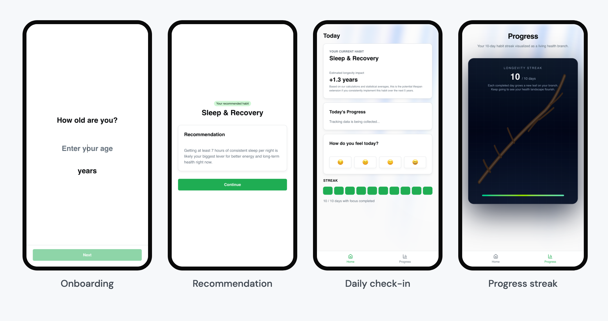
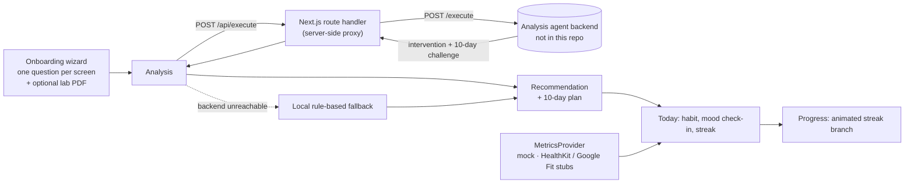

<p align="center">
  <picture>
    <source media="(prefers-color-scheme: dark)" srcset="docs/logo-dark.png">
    
  </picture>
</p>

<p align="center"><strong>One habit, not twenty biohacks.</strong><br>
A longevity app that picks the single lifestyle change with the biggest impact for you and helps you stick to it.</p>

<p align="center">
  
  
  
  
  
  
</p>

---

Most health apps hand you a long list of things to optimize. longevo asks a few questions, one per screen: age, sex, height, weight, sleep, movement, work activity, stress, and optionally a blood test PDF. The answers go to an analysis agent that picks the one intervention with the most expected impact. The agent returns that intervention as a concrete 10-day habit plan. The app then turns the plan into a daily routine with a mood check-in, a streak and a "living branch" that grows with every completed day. This repository contains the mobile-first web app built during the Pelmeni Hackathon (November 2025). The analysis agent ran as a separate backend service and is not part of this repo.

<p align="center">
  
</p>

## How it works



- The lab report is encoded as base64 and sent together with the profile. The proxy allows long agent runs (up to 7 minutes on the client side).
- The agent's `challenge.daily_tasks` become the 10-day plan with an activity and a step target per day.
- If the backend cannot be reached, a transparent local heuristic chooses the lever: sleep under 7 h → sleep; fewer than 4 movement days → movement; stress ≥ 7 → stress; otherwise metabolic health.

## Features

- Full-screen onboarding wizard, one question per screen, with optional PDF upload.
- Recommendation screen with the chosen habit and a day-by-day plan.
- "Today" view with current habit, daily mood check-in and a 10-day streak.
- Progress view with an animated branch that grows with the streak, plus share and community entry points.
- Pluggable `MetricsProvider` interface for activity data (mock implementation; Apple HealthKit and Google Fit stubs).
- App state persisted in `localStorage`, so a refresh keeps your plan.

## Tech stack

| Area | Technology |
| --- | --- |
| Framework | Next.js 16 (App Router, route handlers), React 19, TypeScript |
| UI | Tailwind CSS 4, shadcn/ui on Radix primitives, Motion, lucide-react |
| Integration | Server-side proxy to the analysis agent (`/api/execute`) |

## Quick start

Requires Node.js 20+.

```bash
npm install
npm run dev
```

Open http://localhost:3000. Without a configured backend, the analysis request fails and the local fallback produces the recommendation, so the full flow can be tried offline.

Production build:

```bash
npm run build && npm start
```

## Environment variables

| Variable | Purpose |
| --- | --- |
| `BACKEND_API_URL` | Base URL of the analysis agent, used by the server-side proxy |
| `NEXT_PUBLIC_API_URL` | API base for the browser (default `/api`, the built-in proxy) |

## Project structure

```text
src/
  app/
    page.tsx               # onboarding entry
    loading/  result/      # analysis and recommendation
    app/home/ app/progress # daily view and streak visualization
    api/execute/route.ts   # proxy to the analysis agent
  components/
    onboarding/            # wizard and steps
    progress/              # branch streak visualization
  lib/
    api.ts                 # payload builder, agent client, response mapping
    api-mock.ts            # local fallback heuristic
    tracking-*.ts          # habit plan types, metrics providers, mock data
    app-state.tsx          # React context + localStorage persistence
```

## Status

Hackathon prototype (November 2025). The core flow works end to end. Several parts are placeholders:

- Activity metrics and streaks are simulated by the mock provider. HealthKit and Google Fit are not implemented.
- The "estimated longevity impact" figure on the Today screen is a static placeholder, not a calculation.
- The proxy accepts self-signed certificates (`rejectUnauthorized: false`) for the hackathon backend and must not be used like this in production.
- No user accounts. All data stays in the browser.

## Team

Built at the Pelmeni Hackathon by [Kai Perich](https://github.com/kpr17ch) and [freedave111](https://github.com/freedave111).
